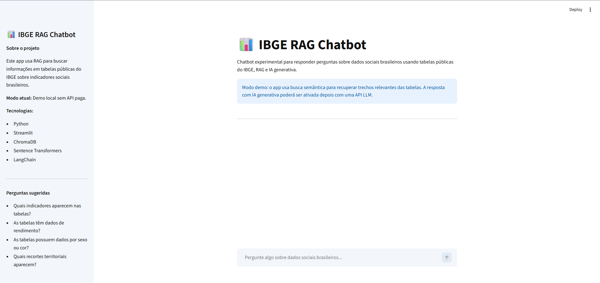
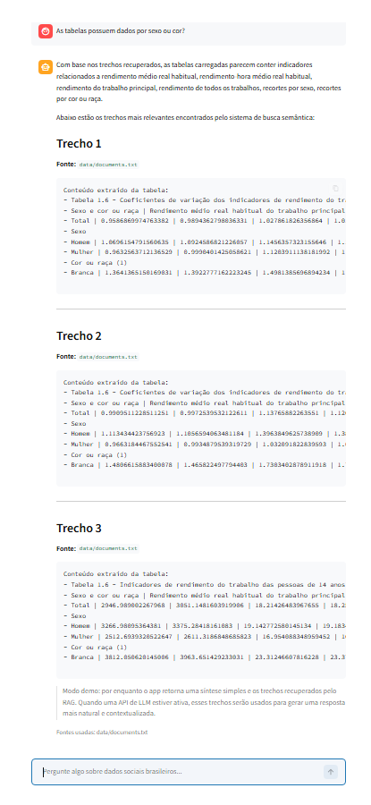

# IBGE RAG Chatbot

Chatbot experimental para responder perguntas sobre dados sociais brasileiros usando tabelas públicas do IBGE, busca semântica e Retrieval-Augmented Generation (RAG).

## Objetivo

O objetivo do projeto é demonstrar uma aplicação prática de Python, análise de dados, embeddings, banco vetorial e interface web com Streamlit.

O sistema permite que o usuário faça perguntas sobre indicadores sociais brasileiros e retorna respostas em linguagem natural com base em trechos relevantes extraídos de tabelas públicas do IBGE.

## Tecnologias utilizadas

- Python
- Streamlit
- LangChain
- ChromaDB
- Sentence Transformers
- Gemini API (plano gratuito)
- Pandas
- OpenPyXL
- xlrd
- pytest e GitHub Actions

## Funcionalidades

- Leitura de tabelas `.xls`, `.xlsx` e `.csv`
- Conversão das tabelas para texto pesquisável
- Criação de base vetorial com ChromaDB
- Busca semântica com embeddings locais (modelo carregado uma única vez por processo)
- Reconstrução automática do índice quando os dados ou a configuração mudam
- Expansão simples de consultas para melhorar recuperação
- Filtro por metadata para separar indicadores e coeficientes de variação
- Integração com Gemini API (plano gratuito) para síntese em linguagem natural
- Fallback demo caso a API generativa não esteja disponível
- Interface web com Streamlit
- Exibição dos trechos e fontes utilizadas (tabela e aba de origem)
- Modo escuro
- Bloqueio do input enquanto a resposta está sendo gerada

## Deploy

A aplicação está disponível em:

https://ibge-rag-chatbot-justmetro.streamlit.app/

## Screenshots

### Tela inicial



### Exemplo de resposta



## Dados utilizados

O projeto utiliza tabelas públicas do IBGE relacionadas a indicadores sociais brasileiros, incluindo informações sobre rendimento, trabalho, sexo, cor ou raça e recortes territoriais.

Exemplos de tabelas carregadas:

- Indicadores por Brasil
- Indicadores por Grandes Regiões e Unidades da Federação
- Indicadores por sexo e cor ou raça
- Indicadores de rendimento do trabalho
- Coeficientes de variação dos indicadores de rendimento

## Exemplos de perguntas

- Quais indicadores aparecem nas tabelas?
- As tabelas têm dados de rendimento?
- As tabelas possuem dados por sexo ou cor?
- Quais recortes territoriais aparecem?
- Compare o rendimento entre homens e mulheres.
- Mostre os coeficientes de variação dos indicadores de rendimento.
- Quais são os valores de rendimento médio real habitual do trabalho principal para Brasil, Norte e Rondônia?

## Estrutura do projeto

```text
ibge-rag-chatbot/
├── app.py
├── requirements.txt
├── requirements-dev.txt
├── .env.example
├── README.md
├── assets/
│   ├── home.png
│   ├── resposta.png
│   └── logo.png
├── data/
│   ├── documents.txt
│   ├── pdfs/
│   └── tables/
├── reports/
│   └── retrieval_evaluation.txt
├── scripts/
│   └── evaluate_retrieval.py
├── src/
│   ├── config.py
│   ├── text_utils.py
│   ├── rag.py
│   ├── vectorstore.py
│   ├── table_loader.py
│   ├── pdf_loader.py
│   ├── prompts.py
│   ├── embedder.py
│   ├── document_filters.py
│   └── query_expansion.py
├── tests/
└── .streamlit/
    └── config.toml
```

## Arquitetura técnica

O projeto segue uma arquitetura RAG simples e modular:

```text
Usuário
  ↓
Interface Streamlit
  ↓
RAGBot
  ↓
Expansão simples de consulta
  ↓
Retriever ChromaDB com filtro por metadata
  ↓
Trechos relevantes das tabelas
  ↓
Gemini API
  ↓
Resposta em linguagem natural + fontes utilizadas
```

Principais módulos:

- `app.py`: interface web com Streamlit
- `src/config.py`: caminhos do projeto e variáveis de ambiente
- `src/text_utils.py`: normalização de texto e busca de palavras inteiras
- `src/table_loader.py`: leitura e conversão de tabelas do IBGE em texto pesquisável
- `src/pdf_loader.py`: loader opcional para documentos PDF
- `src/embedder.py`: configuração do modelo de embeddings local
- `src/vectorstore.py`: criação, carregamento, validação e consulta da base vetorial ChromaDB
- `src/query_expansion.py`: expansão simples de consultas para melhorar recuperação
- `src/document_filters.py`: regras de intenção para lidar com coeficientes de variação
- `src/rag.py`: orquestração do fluxo RAG
- `src/prompts.py`: prompts utilizados pelo Gemini e mensagens de fallback
- `scripts/evaluate_retrieval.py`: avaliação da recuperação semântica

## Decisões técnicas

### Uso de tabelas do IBGE

O projeto foi adaptado para trabalhar com tabelas `.xls`, `.xlsx` e `.csv`, pois muitos dados públicos do IBGE são disponibilizados em formato tabular. As tabelas são convertidas para texto estruturado antes de serem indexadas no banco vetorial.

### Embeddings locais

Foi utilizado o modelo `sentence-transformers/all-MiniLM-L6-v2`, por ser leve, gratuito e adequado para protótipos de busca semântica. Isso reduz custos e permite que a etapa de recuperação funcione sem depender de API externa.

### ChromaDB

O ChromaDB foi escolhido como banco vetorial por ser simples de configurar, persistente localmente e bem integrado ao ecossistema LangChain.

### Gemini API no plano gratuito, com fallback

Quando a variável `GEMINI_API_KEY` está configurada, o app usa Gemini para sintetizar respostas em linguagem natural com base nos trechos recuperados. As regras ficam na instrução de sistema e o contexto recuperado vai delimitado junto da pergunta. Caso a API não esteja disponível ou atinja o limite de uso, o sistema mantém um modo demo que retorna uma síntese simples e os trechos relevantes.

O projeto foi pensado para rodar sem custo, no plano gratuito da Gemini API:

- Os modelos da variável `GEMINI_MODELS` são tentados em ordem. Todos os modelos Flash e Flash-Lite são gratuitos e cada um tem sua própria cota diária; quando um esgota (erro 429), o próximo responde.
- Erros de chave inválida interrompem as tentativas imediatamente, sem gastar chamadas.
- Respostas já geradas ficam em cache enquanto o app está no ar, então perguntas repetidas (como as sugeridas) não consomem cota.
- Como o Google aposenta versões de modelo com frequência, trocar de modelo não exige mudança de código. Falhas de cada modelo são registradas no log.

Os limites atuais da sua chave aparecem em https://aistudio.google.com/rate-limit. No plano gratuito, o Google pode usar o conteúdo das requisições para melhorar seus produtos; aqui isso envolve apenas perguntas e dados públicos do IBGE.

### Índice vetorial versionado

O índice ChromaDB guarda uma impressão digital (hash) dos arquivos de dados, do tamanho de chunk, do modelo de embeddings e do formato dos chunks. Se algum desses itens mudar, ou se uma construção anterior tiver sido interrompida, o índice é reconstruído automaticamente, evitando respostas baseadas em dados antigos.

### Chunks com identidade da tabela

As tabelas são divididas por linha. Cada chunk que não começa no cabeçalho recebe o título da tabela (por exemplo, "Tabela 1.3 - Indicadores ... segundo sexo e cor ou raça"), e trechos finais muito curtos, geralmente só notas de rodapé, são unidos ao chunk anterior. Isso evita que pedaços sem dados dominem a busca.

### Expansão simples de consulta

Foi adicionada uma etapa de expansão simples de consulta para melhorar a recuperação em perguntas sobre sexo, cor ou raça, rendimento, valores monetários, recortes territoriais e coeficientes de variação.

As palavras-chave são comparadas como palavras inteiras e sem acentos. Assim, "cor" não é encontrado dentro de "recortes", e "raca" equivale a "raça".

Essa estratégia ajudou a recuperar melhor tabelas específicas, como comparações entre homens e mulheres ou perguntas sobre rendimento por Brasil, Norte e Rondônia.

### Filtro por metadata

As tabelas de coeficientes de variação são identificadas durante a criação dos documentos e recebem metadata específica no ChromaDB.

Assim, quando o usuário pede valores de rendimento, o sistema evita recuperar coeficientes de variação como se fossem valores monetários. Quando o usuário pede explicitamente coeficientes, essas tabelas são incluídas na busca.

## Avaliação do retriever

Foi criado um script de avaliação em `scripts/evaluate_retrieval.py`, com perguntas representativas sobre os dados carregados.

A avaliação verifica:

- Quantidade de documentos retornados
- Presença de termos esperados nos trechos recuperados
- Precision@k
- Recall proxy
- MRR
- NDCG
- Latência média

Resultado atual da avaliação:

```text
Total de testes: 7
Testes aprovados: 7
Taxa de sucesso simples: 100%
Precision@k médio: 1.000
Recall proxy médio: 0.964
MRR médio: 1.000
NDCG médio: 1.000
Latência média: 0.039s
```

A latência mede apenas as consultas: o modelo de embeddings e o índice são carregados antes da medição e mantidos em cache.

Essa avaliação usa métricas heurísticas baseadas em termos esperados. Ela não substitui um benchmark formal rotulado, mas ajuda a monitorar qualidade de recuperação e latência durante o desenvolvimento.

## Testes e CI

O projeto possui testes automatizados com `pytest`, cobrindo partes centrais da lógica do RAG:

- Expansão de consultas
- Filtros de documentos recuperados
- Normalização de texto
- Chamada ao Gemini, troca de modelo por cota e cache de respostas (com cliente simulado, sem rede)
- Divisão em chunks e extração de fontes
- Métricas da avaliação do retriever

Atualmente, a suíte possui 32 testes unitários.

Também foi configurado um workflow de GitHub Actions em `.github/workflows/tests.yml`, que executa os testes automaticamente a cada `push` ou `pull request`.

Para rodar os testes localmente:

```bash
pip install -r requirements-dev.txt
pytest
```

## Como rodar localmente

Requer Python 3.11 ou superior.

Crie e ative o ambiente virtual:

```bash
python -m venv venv

# Linux/macOS
source venv/bin/activate

# Windows
venv\Scripts\activate
```

Instale as dependências:

```bash
pip install -r requirements.txt
```

Em máquinas sem GPU, é possível instalar o PyTorch apenas para CPU (download bem menor):

```bash
pip install -r requirements.txt --extra-index-url https://download.pytorch.org/whl/cpu
```

Processe as tabelas:

```bash
python src/table_loader.py
```

Crie o índice vetorial (opcional: o app cria automaticamente na primeira pergunta, mas isso pode levar alguns minutos):

```bash
python -m src.vectorstore
```

Rode a avaliação do retriever:

```bash
python scripts/evaluate_retrieval.py
```

Rode o app:

```bash
streamlit run app.py
```

## Variáveis de ambiente

Copie `.env.example` para `.env` e ajuste os valores:

```env
GEMINI_API_KEY=sua_chave_aqui
GEMINI_MODELS=gemini-3.8-flash,gemini-3.5-flash,gemini-3.5-flash-lite,gemini-3.1-flash-lite
RETRIEVER_K=5
```

A chave Gemini é opcional e gratuita (crie uma em https://aistudio.google.com/apikey). Sem ela, o app funciona em modo demo.

No Streamlit Community Cloud, configure as mesmas variáveis em **Settings → Secrets**.

## Status do projeto

Versão atual: MVP funcional com deploy público.

Nesta versão, o sistema recupera trechos relevantes das tabelas carregadas, utiliza Gemini API para sintetizar respostas em linguagem natural quando a variável `GEMINI_API_KEY` está configurada, e mantém um modo demo como fallback caso a API não esteja disponível.

## Cuidados de segurança

Este projeto não versiona arquivos `.env`, `.streamlit/secrets.toml` nem chaves de API. Erros internos são registrados no log e não são exibidos ao usuário.

## Limitações e próximos passos

A versão atual já possui deploy público, recuperação semântica com ChromaDB, integração com Gemini API, fallback demo, testes automatizados e CI com GitHub Actions.

Apesar disso, o projeto ainda pode evoluir em alguns pontos:

- Testar diferentes tamanhos de chunk e valores de `k` no retriever
- Melhorar o tratamento de tabelas complexas do IBGE, especialmente cabeçalhos com múltiplas linhas
- Incluir mais bases públicas sobre educação, trabalho, rendimento e desigualdade
- Exibir gráficos e tabelas resumidas diretamente na interface
- Explorar deploy alternativo em Hugging Face Spaces

## Aprendizados e insights

### Tabelas reais exigem tratamento diferente de PDFs

O projeto começou como um RAG voltado para documentos, mas as fontes públicas do IBGE frequentemente aparecem em formato tabular. Por isso, foi necessário transformar planilhas `.xls`, `.xlsx` e `.csv` em texto estruturado antes da indexação.

Essa decisão tornou o projeto mais alinhado com aplicações reais de dados públicos.

### Query expansion melhorou a recuperação

Perguntas curtas como “As tabelas possuem dados por sexo ou cor?” nem sempre recuperavam os melhores trechos inicialmente.

A solução foi adicionar expansão simples de consulta com termos como `sexo`, `homem`, `mulher`, `cor ou raça`, `rendimento` e `trabalho principal`.

Após essa melhoria, a avaliação passou a recuperar corretamente os termos esperados para as perguntas de teste.

### Metadata reduziu ruído na recuperação

As tabelas de coeficientes de variação apareciam em perguntas sobre valores de rendimento, confundindo o contexto enviado ao modelo de linguagem.

Para resolver isso, os documentos passaram a receber metadata indicando se pertencem ou não a tabelas de coeficientes. O retriever usa essa informação para filtrar resultados quando a pergunta pede valores monetários, mas preserva os coeficientes quando eles são solicitados explicitamente.

### Embeddings locais são suficientes para o MVP

O uso de embeddings locais com `sentence-transformers/all-MiniLM-L6-v2` foi suficiente para o tamanho atual da base. Isso permitiu manter a recuperação semântica sem custo de API, deixando a API generativa apenas para a síntese final da resposta.

### Avaliação simples já ajuda a encontrar falhas reais

Mesmo uma avaliação heurística baseada em termos esperados foi útil para identificar falhas na recuperação, como perguntas sobre sexo e cor ou mistura entre valores de rendimento e coeficientes de variação.

A avaliação evoluiu para incluir Precision@k, Recall proxy, MRR e NDCG, tornando o acompanhamento da qualidade do retriever mais transparente.